# StreamChrome PRO

A Windows companion app and browser launcher for playing local videos in your browser, with selectable subtitles and five switchable layouts.

## Install and open

1. Download **StreamChromePro-Setup-2.4.2.exe** from Releases and run it. The application installs for your Windows account without an administrator prompt.
2. FFmpeg, FFprobe and Python are included. No separate installation or PATH configuration is needed.
3. Open **StreamChrome PRO** from the Start menu. Choose **Open file**, then select your video. Files stay on your computer.
4. Use **Exit** at the far right to stop the application. Closing the browser tab leaves the local server running. You can also right-click its tray icon and choose **Exit / Sair**.

## Browser extension

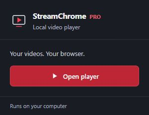

The extension opens the installed StreamChrome PRO application from the browser toolbar.

**Chrome / Chromium:** extract `StreamChromePro-Chromium-2.4.3.zip`. Open `chrome://extensions`, enable Developer mode, choose **Load unpacked**, and select the extracted folder. Click the extension icon, then **Open player**.

**Firefox:** the Firefox package is provided for temporary developer testing through `about:debugging` → This Firefox → Load Temporary Add-on. Permanent installation requires Mozilla signing; this release is not signed or listed in an add-on store.

**Opera:** experimental. Chrome is the primary supported browser for this beta.

The Windows installer registers the native launcher for Chrome, Edge and Firefox. Install the browser extension separately using the steps above.

## Subtitles

Open **Subtitles** and expand **Subtitle settings**. Supply your personal [SubDL API key](https://subdl.com/developers), your [OpenSubtitles.com API key](https://www.opensubtitles.com/en/consumers), or both. OpenSubtitles username and password are optional. Provider download quotas apply.

Search by movie or series title, select a language, and provide season/episode for series. Choose a result and click **Open selected subtitle**. No result is automatically downloaded or applied. A local SRT/VTT can also be opened under Subtitle options. Subtitle delay, size and color are adjustable.

Keys are protected with Windows DPAPI in your local application data, outside this repository. Do not include credentials in issues or screenshots.

## Appearance and NVIDIA video

Choose Cinema, Classic, Studio, Library or Quiet Glass under **Appearance**, with light/dark themes. The interface defaults to English and offers Portuguese and Spanish.

### Cinema

| Dark | Light |
|---|---|
| 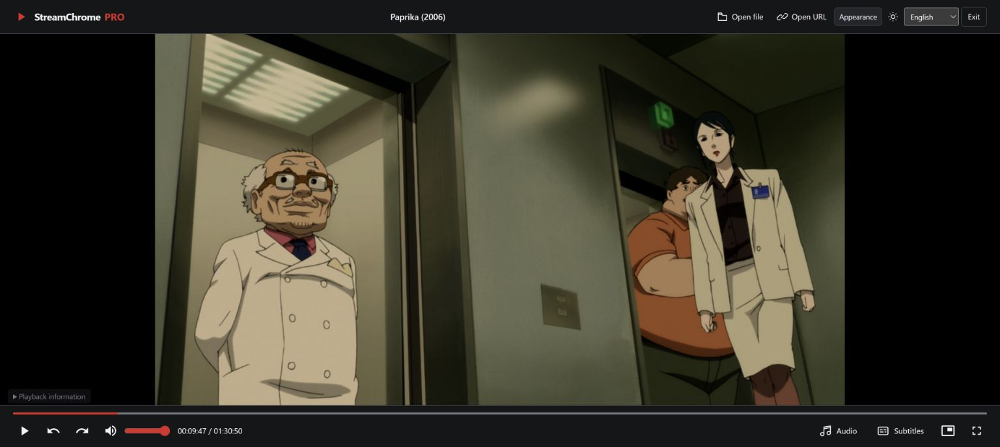 | 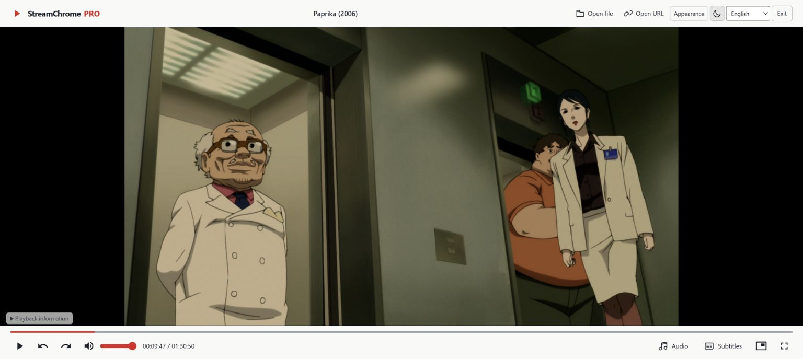 |

### Classic

| Dark | Light |
|---|---|
| 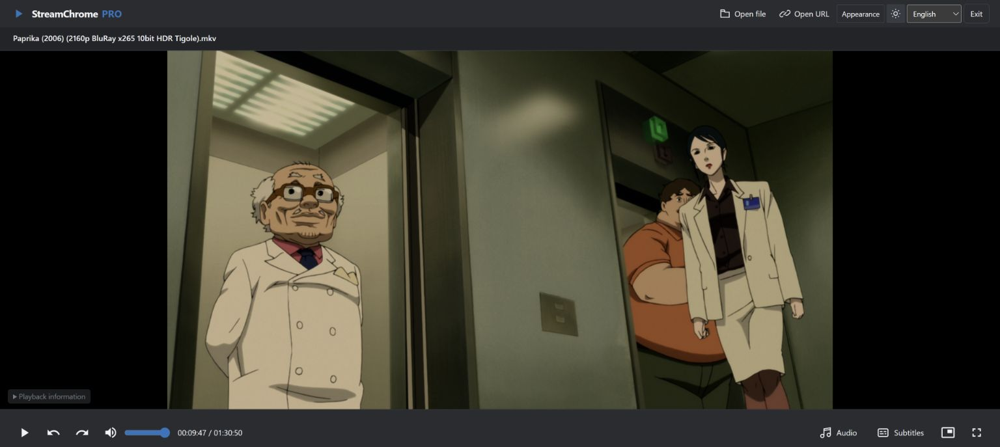 | 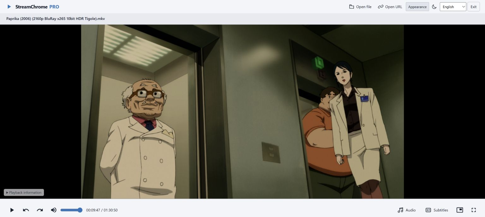 |

### Studio

| Dark | Light |
|---|---|
| 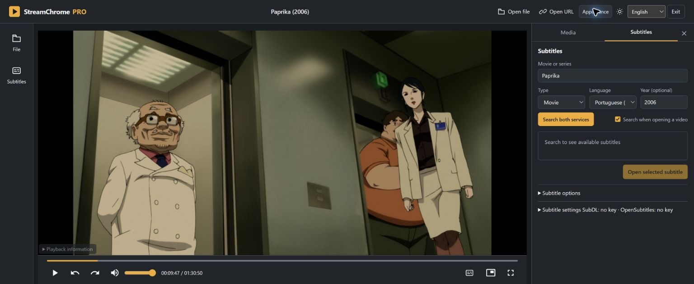 | 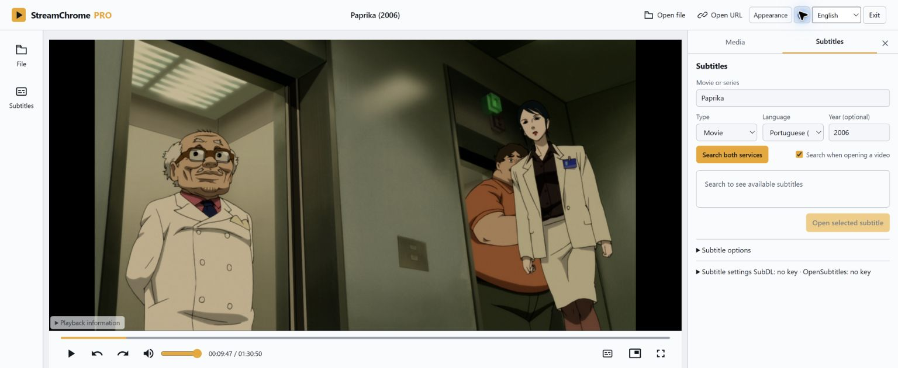 |

### Library

| Dark | Light |
|---|---|
| 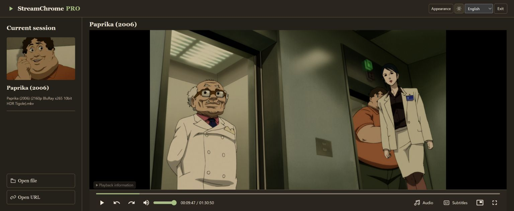 | 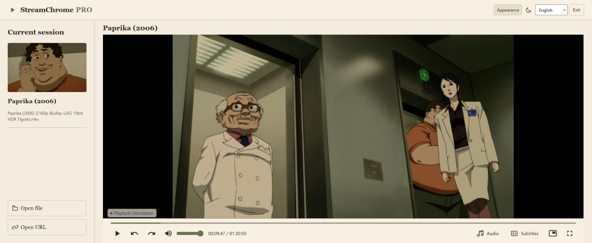 |

### Quiet Glass

| Dark | Light |
|---|---|
| 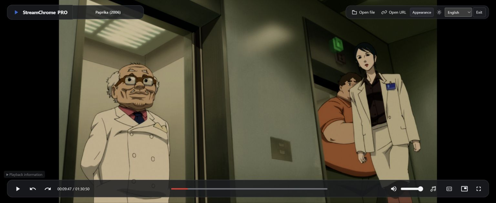 | 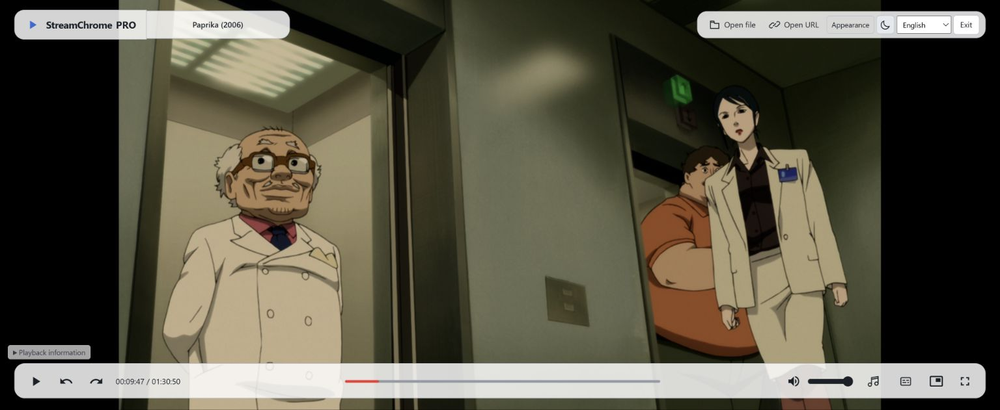 |

Use **Original** mode to preserve supported HEVC, H.264 and AV1 video. Choose **H.264 compatibility** if the original format does not play; conversion may increase CPU usage.

For NVIDIA RTX Video, enable Super Resolution or HDR in the NVIDIA app and check its activity indicator during playback. Availability depends on the GPU, driver, browser and video. **Playback information** displays resolution, dropped frames and buffer statistics.

## Limits of this beta

- Windows 10/11, Chrome as primary browser. Other browsers require testing.
- Supported media formats depend on the browser and FFmpeg. Subtitle timing varies between releases.
- No code-signing certificate: Windows may display an unknown-publisher notice.
- The browser extension is distributed for developer loading; store publication/signing is separate.

## Develop

Use Python 3 and Node.js for tests. Install Python build dependencies with `pip install -r requirements-build.txt`. Run `python -m unittest discover -s tests` and each `tests/*.cjs` with Node. See [build instructions](docs/BUILD.md).

The project runs only on loopback. The native bridge accepts the single `open` action and launches only the adjacent player executable. 

## Credits and support

Created by **OhCato**. [Support development](https://buymeacoffee.com/caique1704u).

FFmpeg, Python, Pillow, pystray and browser APIs belong to their respective maintainers. [FFmpeg distribution details and licenses](docs/THIRD_PARTY.md) are included with the installer. A project license has not yet been selected.
