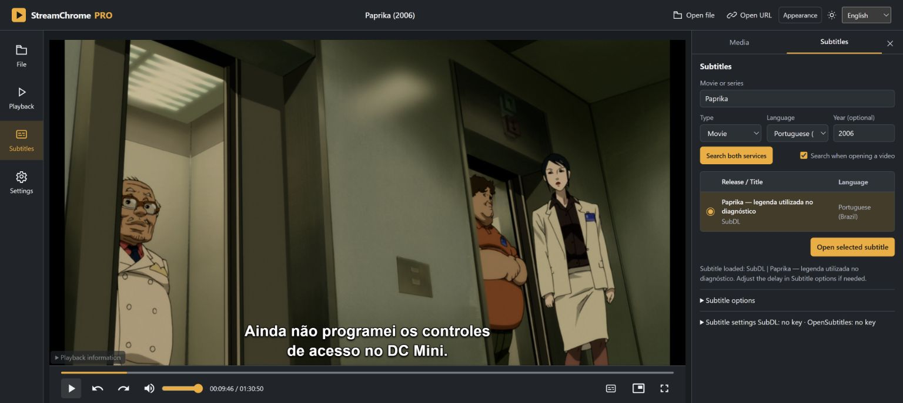

# StreamChrome PRO

A Windows companion app and browser launcher for playing local videos in your browser, with selectable subtitles and five switchable layouts.

## Install and open

1. Download **StreamChromePro-Setup-2.4.0.exe** from Releases and run it. The application installs for your Windows account without an administrator prompt.
2. FFmpeg and FFprobe are required. Install them from a trusted build linked by [FFmpeg](https://ffmpeg.org/download.html), then add their `bin` folder to PATH, or use `C:\Program Files\FFmpeg\bin`. They are **not bundled** in this release. Python is bundled; you do not need to install Python.
3. Open **StreamChrome PRO** from the Start menu. Choose **Open file**, then select your video. Files stay on your computer.
4. Use **Exit** at the far right to stop the application. Closing the browser tab leaves the local server running. You can also right-click its tray icon and choose **Exit / Sair**.

## Browser extension

The extension opens the installed application. It does not inject scripts into websites, collect browsing history, or bypass DRM.

**Chrome / Chromium:** extract `StreamChromePro-Chromium-2.4.0.zip`. Open `chrome://extensions`, enable Developer mode, choose **Load unpacked**, and select the extracted folder. Click the extension icon, then **Open player**. The stable extension ID is pinned in its manifest.

**Firefox:** the Firefox package is provided for temporary developer testing through `about:debugging` → This Firefox → Load Temporary Add-on. Permanent installation requires Mozilla signing; this release is not signed or listed in an add-on store.

**Opera:** the Chromium package is included for compatibility testing. Native Messaging behavior must be verified in Opera before treating it as supported. Chrome is the primary target for this beta.

The Windows installer registers the native launcher for Chrome, Edge and Firefox. Installing the app does not silently install a browser extension; browsers require their own installation flow.

## Subtitles

Open **Subtitles** and expand **Subtitle settings**. Supply your personal [SubDL API key](https://subdl.com/developers), your [OpenSubtitles.com API key](https://www.opensubtitles.com/en/consumers), or both. OpenSubtitles username and password are optional: API-key-only search and download worked in the user's test, subject to provider quotas and policies.

Search by movie or series title, select a language, and provide season/episode for series. Choose a result and click **Open selected subtitle**. No result is automatically downloaded or applied. A local SRT/VTT can also be opened under Subtitle options. Subtitle delay, size and color are adjustable.

Keys are protected with Windows DPAPI in your local application data, outside this repository. Do not include credentials in issues or screenshots.

## Appearance and NVIDIA video

Choose Cinema, Classic, Studio, Library or Quiet Glass under **Appearance**, with light/dark themes. The interface defaults to English and offers Portuguese and Spanish.

Quiet Glass uses translucent controls without backdrop blur over the video. Sampling the video backdrop can affect the browser compositor; removing it is a compatibility change, **not proof that the NVIDIA driver activated an effect**.

Original mode preserves supported HEVC/H.264/AV1 video and converts audio when needed. H.264 compatibility mode may transcode video and consume more CPU. HDR preservation, RTX Video HDR conversion and RTX Video Super Resolution are separate behaviors. Check the NVIDIA indicator during playback. Playback information shows browser dimensions and frame/buffer metrics; it cannot read the driver's activation state.

## Limits of this beta

- Windows 10/11, Chrome as primary browser. Other browsers require testing.
- No DRM circumvention or guaranteed support for every container, codec, audio format or subtitle release.
- No code-signing certificate: Windows may display an unknown-publisher notice.
- FFmpeg/FFprobe are separate prerequisites.
- The browser extension is distributed for developer loading; store publication/signing is separate.
- Closing a browser tab does not shut down the companion. Use Exit or the tray menu.

## Develop

Use Python 3 and Node.js for tests. Install Python build dependencies with `pip install -r requirements-build.txt`. Run `python -m unittest discover -s tests` and each `tests/*.cjs` with Node. See [build instructions](docs/BUILD.md).

The project runs only on loopback. The native bridge accepts the single `open` action and launches only the adjacent player executable. Release archives exclude personal videos, keys, local logs, build scratch files and prior executable versions.

## Credits and support

Created by **OhCato**. [Support development](https://buymeacoffee.com/caique1704u).

FFmpeg, Python, Pillow, pystray and browser APIs belong to their respective maintainers. FFmpeg is not redistributed in these releases. No software license is granted by omission; a project license has not yet been selected.
